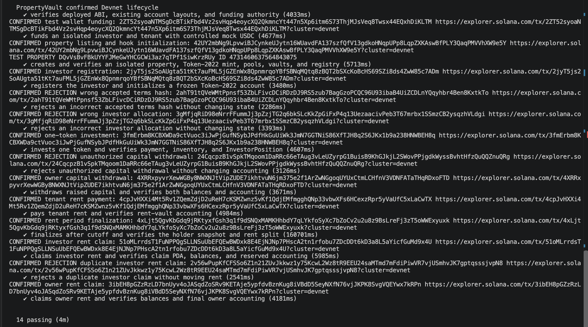

# PropertyVault

### Tokenized Real Estate Investment and Rental Income Distribution on Solana

PropertyVault is a Solana-based application that explores how real estate investment and rental income management can be made more transparent through blockchain technology.

Traditionally, investing in real estate requires significant capital, and managing investment records, rental payments, and revenue distribution often involves multiple intermediaries.

PropertyVault takes a different approach: property owners can represent investment participation using blockchain tokens, investors can participate with smaller amounts of capital, and rental income can be distributed according to predefined rules enforced by smart contracts.

The project is built using **Rust, Anchor, Solana, and Token-2022**, with a web frontend developed using **React and TypeScript**.


---

## 1. The Problem

Real estate is a valuable asset class, but participation and management can be difficult.

Some common challenges include:

- **High entry barriers:** Purchasing an entire property requires substantial capital.
- **Limited transparency:** Investors may have limited visibility into how funds and rental income are managed.
- **Manual distribution:** Calculating and distributing rental income can involve manual accounting.
- **Complex ownership records:** Tracking investment participation and transfers can be difficult.
- **Trust requirements:** Participants often depend on intermediaries to maintain accurate records.

PropertyVault investigates how smart contracts can simplify some of these processes.

## 2. The Solution

PropertyVault uses Solana programs to manage property investment participation and rental income accounting.

The system has three main participants:

| Participant | Role |
|---|---|
| **Property Owner** | Lists and tokenizes a property, creates investment opportunities, and manages permitted capital withdrawals |
| **Investor** | Registers, invests in a property, receives participation tokens, and claims eligible rental income |
| **Tenant** | Makes rental payments that are recorded and managed through the protocol |

The objective is to make important financial operations traceable and enforce their rules through on-chain programs.

---

## 3. Core Features

### Property Listing and Tokenization

A property owner can initialize a property listing and create the associated Token-2022 mint.

The protocol creates the required on-chain accounts to track property configuration, investment participation, and rental income.

### Investment Management

Investors can register and participate in a property's investment pool.

When an investment is accepted, the protocol records the investor's position and processes the associated token and payment operations.

### Token-2022 Transfer Restrictions

PropertyVault uses a separate Transfer Hook program to validate applicable property-token transfers.

This allows transfer restrictions to be enforced at the token-program level instead of relying entirely on frontend checks.

### Capital Withdrawal

The authorized property owner can withdraw eligible raised capital.

Unauthorized withdrawal attempts are rejected by the smart contract.

### Rental Payments

A tenant can make a rental payment into the property's designated rent vault.

The protocol records the payment and maintains the associated accounting state.

### Rental Income Distribution

After the configured rental period cutoff, the protocol can finalize the period and calculate the applicable distribution using its recorded holder snapshot and allocation rules.

### Investor and Owner Claims

Eligible investors can claim their share of rental income, while the property owner can claim the applicable owner allocation.

Claim records and accounting checks help prevent duplicate withdrawals.

---

## 4. System Architecture

PropertyVault uses two Solana programs with separate responsibilities.

### Main PropertyVault Program

Handles:

- Property initialization and tokenization
- Investor registration
- Investment processing
- Investment position accounting
- Capital withdrawal
- Rental payments
- Rental period finalization
- Investor rental claims
- Owner rental claims

### PropertyVault Transfer Hook Program

Handles validation of applicable Token-2022 property-token transfers.

The Transfer Hook is deployed separately because Solana's Token-2022 Transfer Hook extension invokes a designated program during supported transfer operations.

### Simplified Architecture

```text
                   PROPERTYVAULT
                         |
           +-------------+-------------+
           |             |             |
         Owner        Investor        Tenant
           |             |             |
           +-------------+-------------+
                         |
                  Web Frontend
                React + TypeScript
                         |
                         v
                Solana Transactions
                         |
                         v
             PropertyVault Main Program
                         |
           +-------------+-------------+
           |             |             |
      Property State  Investment     Rent State
                      Accounting     & Claims
           |             |             |
           +-------------+-------------+
                         |
                    Token-2022
                         |
                         v
                Transfer Hook Program
                         |
                  Transfer Validation
```

This is a simplified conceptual diagram. It does not show every PDA, token account, instruction, or CPI.

### Detailed Architecture Document


The complete architecture is documented separately in a PDF.

It covers the detailed program structure, account relationships, instruction flows, and implementation decisions.

**View the Complete PropertyVault Architecture (https://drive.google.com/file/d/1r_uU9G1T24XVf7xDkExTvHeEzk_lJV7K/view?usp=drive_link)**

---

## 5. Technology Stack

| Layer | Technology |
|---|---|
| Blockchain | Solana |
| Smart Contracts | Rust |
| Smart Contract Framework | Anchor |
| Token Standard | SPL Token-2022 |
| Transfer Validation | Token-2022 Transfer Hook |
| Frontend | React, TypeScript |
| Frontend Tooling | Vite |
| Blockchain Interaction | Solana Web3.js |
| Testing | Mocha, TypeScript, Solana Devnet |
| Development Tools | Solana CLI, Anchor CLI, Cargo, Git |

---

## 6. Solana Devnet Deployments

Both programs are deployed on **Solana Devnet**.

### Main PropertyVault Program

**Program ID**

`DA1iVaPWd7epSAong3cGz8jX7rRJMT42zfrHWo3z5123`

**[View Main PropertyVault Program on Solana Explorer](https://explorer.solana.com/address/DA1iVaPWd7epSAong3cGz8jX7rRJMT42zfrHWo3z5123?cluster=devnet)**

This program manages property listings, investment accounting, rental payments, period finalization, and claims.

### PropertyVault Transfer Hook Program

**Program ID**

`3eKZN7MKpkU7gjaYFdR8zV6UCr8u7FeBTKBLe2yeM6J5`

**[View Transfer Hook Program on Solana Explorer](https://explorer.solana.com/address/3eKZN7MKpkU7gjaYFdR8zV6UCr8u7FeBTKBLe2yeM6J5?cluster=devnet)**

This program implements the transfer-validation logic used with Token-2022 property tokens.

### Mock USDC

The Devnet tests use a mock USDC token for testing payment and accounting flows.

**Mock USDC Mint**

`BoEucuYbF4nRNQqq35K7Fr9d7T5kRfJA32is5NiijGAZ`

The mock token has no claim to real USDC reserves or monetary value.

---

## 7. Verified Devnet Functional Tests

The deployed PropertyVault programs were tested using an automated TypeScript integration test suite.

The tests interact with actual Solana Devnet accounts and transactions rather than relying only on a local validator.

### Final Test Result

**14 tests passed. 0 failures.**



### Test Coverage

| Test Scenario | Result |
|---|---|
| Verify deployed program ABI and account layouts | Passed |
| Fund isolated test participants | Passed |
| Create property, token mint, pools, and vaults | Passed |
| Register investor and initialize Token-2022 account | Passed |
| Reject incorrect accepted terms hash | Passed |
| Reject stale investor allocation | Passed |
| Process investment and verify accounting | Passed |
| Reject unauthorized capital withdrawal | Passed |
| Process authorized owner capital withdrawal | Passed |
| Process tenant rental payment | Passed |
| Finalize rental period and verify distribution | Passed |
| Process investor rental claim | Passed |
| Reject duplicate investor rental claim | Passed |
| Process owner rental claim | Passed |

The rejection tests verify that invalid transactions are rejected without unintended changes to the relevant on-chain accounting state.

### Detailed Test Evidence

The repository includes:

- [`tests/devnet.test.ts`](tests/devnet.test.ts) — Automated Devnet lifecycle tests
- [`tests/fixtures/`](tests/fixtures/) — Deployed-compatible IDL fixtures
- [`docs/devnet-test-results.md`](docs/devnet-test-results.md) — Confirmed transaction evidence
- [`docs/devnet-final-output.txt`](docs/devnet-final-output.txt) — Terminal test output

The test records contain transaction signatures that can be inspected independently on Solana Explorer.

---

## 8. Running the Project Locally

### Prerequisites

Install the following tools:

- Node.js
- Rust and Cargo
- Solana CLI
- Anchor CLI
- Yarn or npm

Use toolchain versions compatible with the repository configuration.

### Clone the Repository

```bash
git clone https://github.com/Debagithub567/property-vault.git
cd property-vault
```

### Install Root Dependencies

```bash
yarn install
```

### Build the Anchor Programs

```bash
anchor build
```

Building locally does not automatically deploy or upgrade the programs on Devnet.

### Run the Frontend

```bash
cd frontend
npm install
npm run start
```

The frontend uses Vite. Review `frontend/.env.example` and the frontend integration notes for environment configuration.

### Run Devnet Functional Tests

From the repository root:

```bash
node --import tsx ./node_modules/mocha/bin/mocha.js --timeout 120000 tests/devnet.test.ts
```

**Important:** The Devnet tests submit real transactions to the test network, create fresh test accounts, and consume Devnet SOL and mock USDC.

They require suitable RPC configuration, test-wallet access, and the deployed-compatible IDL fixtures.

The test suite should not be treated as a read-only check.

---

## 9. Security and Validation

Because PropertyVault manages tokenized investment participation and financial accounting, security is an important part of its design.

The implementation includes checks for:

- Authorized access to sensitive operations
- Investor acceptance of the configured property terms
- Investor allocation consistency
- Token transfer validation
- Investment and withdrawal accounting
- Rental distribution accounting
- Duplicate rent-claim prevention

The Devnet tests explicitly verify several rejection scenarios, including invalid terms, stale allocation, unauthorized capital withdrawal, and duplicate claims.

### Security Limitations

PropertyVault is a proof of concept.

It has not been presented as independently audited or production-ready.

Passing automated tests demonstrates the behavior of the tested scenarios, but it does not guarantee the absence of vulnerabilities.

The deployed programs are upgradeable, and their current Explorer build-verification status should not be confused with an independent security audit.

---

## 10. Current Scope and Limitations

PropertyVault demonstrates an on-chain property investment and rental-income lifecycle.

However, several aspects of a real-world property investment platform are outside the current scope.

These include:

- Legal ownership and enforceability of property-token rights
- Regulatory compliance and real-world KYC/AML
- Independent property valuation and verification
- Production-grade custody and payment infrastructure
- Independent smart contract security auditing
- Secondary-market liquidity and comprehensive investor protections

The project should therefore be understood as a technical demonstration of tokenized participation and programmable rental accounting.

### Frontend Status

The repository contains a React-based frontend and supporting interaction code.

The reported 14 passing Devnet tests validate the deployed smart-contract lifecycle. They do not, by themselves, establish that every browser-based frontend workflow has been tested end to end.

---

## 11. Future Improvements

Potential future work includes:

- Full frontend-to-Devnet integration and browser-based end-to-end testing
- Stronger identity and compliance workflows
- Property documentation and verification processes
- More detailed investor reporting and portfolio analytics
- Independent smart contract security review
- Reproducible build verification and security reporting metadata
- Production-oriented monitoring and operational controls

---

## 12. Project Resources

| Resource | Link |
|---|---|
| Main Anchor Program | [Solana Devnet Explorer](https://explorer.solana.com/address/DA1iVaPWd7epSAong3cGz8jX7rRJMT42zfrHWo3z5123?cluster=devnet) |
| Transfer Hook Program | [Solana Devnet Explorer](https://explorer.solana.com/address/3eKZN7MKpkU7gjaYFdR8zV6UCr8u7FeBTKBLe2yeM6J5?cluster=devnet) |
| Detailed Architecture PDF | [Google Drive — Add Link](https://drive.google.com/file/d/1r_uU9G1T24XVf7xDkExTvHeEzk_lJV7K/view?usp=sharing) |
| Devnet Test Evidence | [Test Results](docs/devnet-test-results.md) |
| Test Screenshot | [14 Passing Tests](docs/images/devnet-tests-passing.png) |

---

## Final Note

PropertyVault explores how Solana smart contracts can make property investment participation and rental-income accounting more transparent and programmable.

The primary milestone of this proof of concept is a deployed on-chain lifecycle covering property initialization, investment, rental payments, distribution, and claims, supported by **14 passing Devnet functional tests**.

The broader goal is to investigate how blockchain-based infrastructure can support more accessible and verifiable real-world asset applications.

---

**Network:** Solana Devnet  
**Status:** Proof of Concept  
**On-chain Functional Tests:** 14 Passing / 0 Failing
